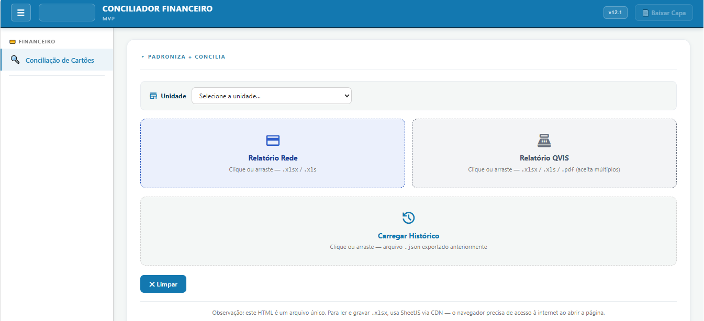
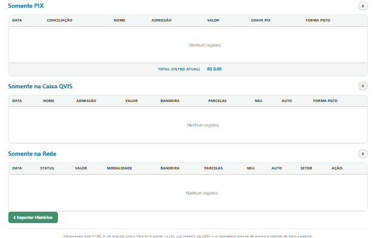
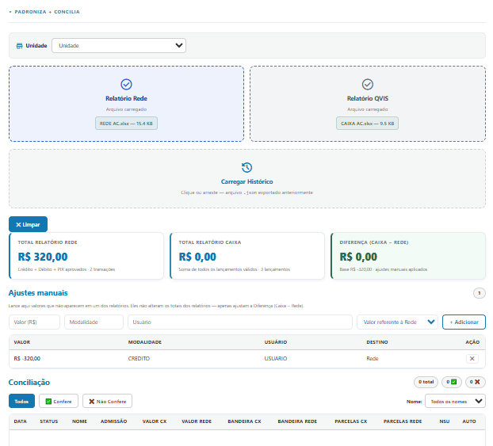

# Conciliador Financeiro

Ferramenta web de página única (HTML + JavaScript) para **padronizar e conciliar** os relatórios de cartão da **Rede** com o caixa do sistema **QVIS**, por unidade.

Todo o processamento acontece **no navegador**: nenhum arquivo é enviado a servidores.



## Funcionalidades

- Importa o **Relatório Rede** (`.xlsx` / `.xls`) e o **Relatório QVIS** (`.xlsx` / `.xls` / `.pdf`, aceita vários arquivos).
- Padroniza os cabeçalhos dos dois relatórios e permite baixar as planilhas padronizadas.
- Concilia as transações por chave (NSU + autorização, ou PIX) e classifica cada uma como **Confere** ou **Não confere**, listando as divergências (valor, bandeira, parcelas, NSU, autorização).
- Separa o que existe só em um dos lados: **Somente PIX**, **Somente na Caixa QVIS** e **Somente na Rede**.
- **Ajustes manuais** que corrigem a diferença Caixa − Rede sem alterar os totais dos relatórios.
- Filtros por status, nome, data e empresa.
- **Exportar / carregar histórico** (`.json`) para retomar uma conciliação depois.
- **Baixar Capa**: PDF de uma página com o resumo da conciliação.

| Resultados por categoria | Conciliação com totais e ajustes |
|---|---|
|  |  |

## Como usar

1. Abra o `index.html` no navegador (ou acesse a versão publicada, se houver GitHub Pages ativo).
2. Selecione a **unidade**.
3. Arraste o **Relatório Rede** e o **Relatório QVIS**.
4. Revise a conciliação, lance ajustes manuais se necessário e use **Exportar Histórico** ou **Baixar Capa**.

> **Requer internet ao abrir a página.** As bibliotecas abaixo são carregadas por CDN.

## Dependências (via CDN)

| Biblioteca | Versão | Uso |
|---|---|---|
| [SheetJS (xlsx)](https://sheetjs.com/) | 0.18.5 | Leitura e escrita de planilhas |
| [PDF.js](https://mozilla.github.io/pdf.js/) | 3.11.174 | Leitura de relatórios QVIS em PDF |
| [jsPDF](https://github.com/parallax/jsPDF) | 2.5.1 | Geração da capa em PDF |
| [jsPDF-AutoTable](https://github.com/simonbengtsson/jsPDF-AutoTable) | 3.8.2 | Tabelas na capa |
| Material Symbols (Google Fonts) | — | Ícones |

## Estrutura do repositório

```
.
├── index.html          # aplicação completa (arquivo único)
├── README.md
├── CHANGELOG.md
├── .gitignore
└── docs/
    ├── regras-de-negocio.md
    └── screenshots/
```

## Documentação

- [Regras de negócio da conciliação](docs/regras-de-negocio.md)
- [Histórico de versões](CHANGELOG.md)

## Privacidade e dados

Relatórios financeiros e arquivos de histórico (`.json`) contêm dados reais de pacientes e transações. O `.gitignore` deste repositório bloqueia `.xlsx`, `.xls`, `.pdf` e `.json` na raiz para evitar commits acidentais. **Não versione relatórios reais.**

## Licença

Uso interno. Defina a licença aqui caso o projeto seja aberto.
